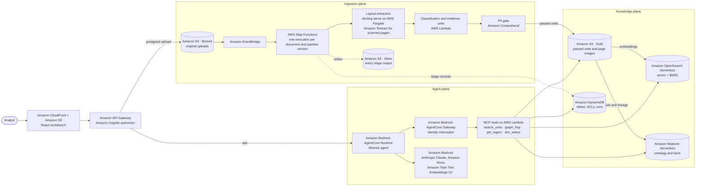

# Document AI and ontology patterns on AWS

**Make every figure your RAG system states traceable to a region of a page.**

This repository holds five reusable patterns for retrieval-augmented generation (RAG) over business documents.
It includes a reference pipeline that runs on your laptop or on AWS, and one complete use case built on top of
it, called **Provenant** (*Every answer, provenance included.*). Take the patterns, the code or both, and apply
them to your own documents.

> **How the code is organized in this release (v0.1).** The pipeline, agent tools and infrastructure are
> domain-neutral, but Provenant's domain files (its document types and financial concepts, two SPARQL
> templates, the answer prompt, the golden questions and the sample-data generator) still sit next to them at
> the repository root. [usecases/README.md](usecases/README.md#what-is-shared-and-what-is-provenant) lists
> exactly which files are Provenant's and which are shared. Moving the domain files into one
> `usecases/provenant/` folder (a "domain pack") is planned for the next release.

> **All sample data is fictitious.** Every document was generated for this repository (the company is
> "NewAge Global Fintech", and every person has the surname "Fictus"). Every page carries the footer
> *Fictitious document · NewAge Global Fintech · for demonstration only*. Do not upload real personal data
> while you experiment.

---

## Contents

- [Why enterprise RAG fails](#why-enterprise-rag-fails)
- [The five patterns](#the-five-patterns)
- [Architecture](#architecture)
- [Choose your path](#choose-your-path)
- [Spin COA up and down](#spin-coa-up-and-down)
- [Prerequisites](#prerequisites)
- [Costs](#costs)
- [Repository map](#repository-map)
- [Security and responsible use](#security-and-responsible-use)
- [Contributing](#contributing) · [License](#license) · [Credits](#credits)

---

## Why enterprise RAG fails

Most RAG failures start in preprocessing, before retrieval or generation runs. A PDF text layer returns
characters in drawing order, not reading order. Labels drift away from their values. Footnotes end up on a
different page from the figures they qualify. Fixed-size chunks then cut tables, captions and footnotes apart.
After that, no retriever or model can recover which value belonged to which label. Even when the answer happens
to be right, nobody can prove where it came from.

The rule this repository follows is **the region boundary has to hold**. Every figure is tied, from extraction to
answer, to a typed region of a page (page number plus bounding box) that a person can open and check.

### Before and after, on the same question

The same agent, prompt, retriever and model answered the same question over two pipeline versions. This
repository calls each pipeline version a **lane**: the same documents go through both lanes side by side, and
their configurations differ only in preprocessing.

- **`1.0`** extracts the PDF text layer and cuts fixed 300-token chunks. This is the **control lane**: the
  baseline that shows what the same agent does without the patterns.
- **`2.3.1`** uses layout-aware extraction, evidence units and ontology binding.

> **Illustrative runs, not a benchmark.** These are a handful of local runs on synthetic documents, made on a
> developer machine with real Amazon Bedrock model calls against the local pipeline's outputs, not the deployed
> AWS stack. They show the failure mode. They do not measure accuracy on your corpus.

The question was *"What is the total income across this package?"*, asked over the fictitious `lending-02`
package (two W-2s, two payslips and a bank statement). The expected answer is 188,090.00, the sum of W-2 Box 1
wages.

| | `1.0` text layer + fixed chunks | `2.3.1` layout + evidence units |
|---|---|---|
| Answer | **199,000.00** (103,000.00 + 96,000.00) | **188,090.00** (97,850.00 + 90,240.00) |
| What went wrong or right | The values were read from chunk text with their labels detached. Both are W-2 Box 3 (Social Security wages), not Box 1 | Each value is a typed field (`fin:W2WagesBox1`) inside an evidence unit |
| Citation | `chunk c-01`: *"chunk has no page region"* | W-2, page 1, Box 1, with a bounding box you can open |
| Logged runs | 6 attempted: 4 with Anthropic Claude Sonnet 4.6 (3 answered 199,000.00, 1 agent error) and 2 with Anthropic Claude Opus 4.6 (both agent errors). **0 correct** | 5 attempted: 2 with Anthropic Claude Sonnet 4.6 and 3 with Amazon Nova 2 Lite. **5 correct**, 5 with valid citations |
| Example run | `r-116947039cb1` | `r-6d0df2be061a` (Claude Sonnet 4.6), `r-18322635acdb` (Amazon Nova 2 Lite) |

On this package the difference is **correctness**: the control lane read the wrong box.

On the first lending package (same question, expected 169,650.00) the difference is **provability**. With
Claude Sonnet 4.6, both lanes returned the right number in 10 of 10 runs (`r-ae7d90b38217` on `1.0`,
`r-99bf456c5a2c` on `2.3.1`). Only `2.3.1` could prove it: its citations resolved to a page region in 10 of 10
runs, against 0 of 10 on `1.0`. A right number that you cannot trace is still a problem in a regulated workflow.
These are the runs asked as the lending analyst, who owns the package. `runs/local/index.json` also holds 2 runs
per lane asked as a markets analyst, a user in another group: the access filters refused them, so they carry no
total and are not counted above.

Every run cited here is a file in [`runs/local/`](runs/local/), indexed in
[`runs/local/index.json`](runs/local/index.json). The [evaluation page](docs/methodology/evaluation.md) has the
results per question type, and where both lanes still fail.

**Reproduce it.** Asking questions needs Amazon Bedrock credentials (a few US cents per question, an estimate).
After [Path 1](#1-local-quickstart-no-aws-account):

```bash
make e2e-packages      # builds lending-02 and two more packages; calls Amazon Bedrock for embeddings on a fresh clone
make local-ask BUILD=build/e2e-lending-02 QID=q-lend2-01 REPEAT=3
make local-ask-summary # prints the N-of-N table: runs per question, lane and model, with run ids
```

---

## The five patterns

Each pattern has a page with the problem, the principle, where it lives in the code, how to adopt it in your own
pipeline, the common pitfalls and how to evaluate it.

| # | Pattern | The rule | Plane | Deep dive | Hands-on |
|---|---|---|---|---|---|
| 1 | **Layout-aware extraction** | Extract regions with roles and bounding boxes, never a flat text stream | Ingestion | [Methodology](docs/methodology/01-layout-aware-extraction.md) | [Quickstart 3](docs/quickstarts/03-layout-aware-extraction.md) |
| 2 | **Evidence units with invariants** | Build retrievable units around tables, figures and field groups, and keep their captions, unit labels and footnotes attached. *Status: the invariants (I1, I2) are specified and recorded in every build report, but not yet enforced; the footnote marker link, field boxes and review queue are enforced* | Ingestion | [Methodology](docs/methodology/02-evidence-units.md) | [Quickstart 4](docs/quickstarts/04-evidence-units.md) |
| 3 | **Ontology-driven classification** | Type documents and fields against a governed vocabulary. A footnote becomes a property, not loose text | Ingestion → Knowledge | [Methodology](docs/methodology/03-ontology-driven-classification.md) | [Quickstart 5](docs/quickstarts/05-ontology-binding-and-sparql.md) |
| 4 | **Metadata at ingestion, filters inside the query** | Write access, version and type metadata onto every unit. Filter inside every sub-query, never after ranking | Knowledge → Agent | [Methodology](docs/methodology/04-metadata-and-filters-inside-the-query.md) | [Quickstart 6](docs/quickstarts/06-metadata-and-filtered-hybrid-search.md) |
| 5 | **Resolve → retrieve → hop → assemble → cite** | The agent resolves the definition, retrieves units, hops the graph for typed facts, then assembles an answer whose every figure cites a region a tool returned | Agent | [Methodology](docs/methodology/05-resolve-retrieve-hop-assemble-cite.md) | [Quickstart 7](docs/quickstarts/07-agent-resolve-retrieve-hop-cite.md) |

Two cross-cutting pages explain how the patterns are held together:

- [The provenance contract](docs/methodology/provenance-contract.md): what every unit, field, answer and run
  must carry, and how the code enforces it.
- [Evaluation](docs/methodology/evaluation.md): a golden set with gold regions, metrics reported per question
  type and per pipeline version, and a control lane. Hands-on: [Quickstart 9](docs/quickstarts/09-evaluation-harness.md).

Governance runs through all of them: a PII gate holds units with unmasked identifiers before anything is indexed.
Hands-on: [Quickstart 8](docs/quickstarts/08-pii-gate.md).

Start with the [methodology overview](docs/methodology/README.md) if you are new to these ideas.

---

## Architecture

Three planes, all on AWS. The [architecture guide](docs/architecture.md) covers the data flow through Bronze,
Silver and Gold, the stage machine, the contracts and the security model.



The same stage code also runs **locally**, in process, with labeled stand-ins for the AWS services. The table in
[docs/architecture.md](docs/architecture.md#local-mode-what-is-real-and-what-is-a-stand-in) lists what is real
and what is a stand-in in each mode.

---

## Choose your path

| Path | Time (estimate) | You need | Start here |
|---|---|---|---|
| **1. Run it locally** | About 5 minutes of your time; 5–10 minutes of installs (10–20 with the optional Docling) | Python 3.12, GNU Make. No AWS account | [Below](#1-local-quickstart-no-aws-account), then [Quickstart 1](docs/quickstarts/01-run-locally.md) |
| **2. Deploy to AWS** | 30–45 minutes, mostly waiting | An AWS account, AWS CLI v2, Node.js 22 | [Below](#2-deploy-to-aws), then [Quickstart 2](docs/quickstarts/02-deploy-to-aws.md) |
| **3. Use the patterns in your own app** | 15–30 minutes per pattern; 1–2 hours for your own documents | Path 1 | [Below](#3-use-the-patterns-in-your-own-application), then [Build your own use case](docs/quickstarts/10-build-your-own-use-case.md) |
| **4. Explore the Provenant use case** | 10 minutes | Path 1 and Node.js 22 | [Below](#4-explore-the-provenant-use-case) |

### 1. Local quickstart (no AWS account)

```bash
git clone https://github.com/Vivek0712/document-ai-ontology-patterns-on-aws.git
cd document-ai-ontology-patterns-on-aws

make venv PY=python3.12     # virtual environment with every component's requirements
make e2e-local PII=local    # builds the ontology, then runs both pipeline versions on the lending sample, offline
```

`make e2e-local` builds the ontology first, then runs both pipeline versions through `ready` on the five
documents in `data/samples/lending/`. Keep `PII=local`: without it, the run uses recorded Amazon Comprehend
responses and calls Amazon Comprehend for anything not recorded, which needs credentials. AWS is emulated in process (moto for Amazon S3
and Amazon DynamoDB, pyoxigraph for the graph, a regex stand-in for Amazon Comprehend). No AWS resource is
created and no AWS call is made.

Open these files when it finishes:

| File | What it shows |
|---|---|
| `build/e2e/diff.md` | For each document: `1.0` chunks next to `2.3.1` evidence units, and every field whose label and value were split apart in `1.0` |
| `build/e2e/graph/qi_sum.json` | The real `graph_hop` tool answering "total income" over the graph the pipeline wrote. The expected total is **169,650.00** = 98,400.00 + 71,250.00, with the unit and field IRI of each operand |
| `build/e2e/run.json` | Which engines actually ran. Every stand-in is labeled, for example *"pyoxigraph in-process (NOT Amazon Neptune)"* |
| `build/e2e/status/` | Every stage record and event, as the stage inspector shows them |

> **About Docling.** Layout extraction for digital pages uses the open-source
> [Docling](https://github.com/docling-project/docling) package. It is an optional install of about 1.4 GB.
> Docling's code is MIT-licensed; the layout and table models it downloads are Apache-2.0 and
> CDLA-Permissive-2.0 (see [THIRD_PARTY_LICENSES.md](THIRD_PARTY_LICENSES.md)).
> Without it, the `2.3.1` lane uses a clearly labeled pypdfium2 fallback and skips scanned pages. `run.json`
> tells you which one ran. For full local extraction, run:
>
> ```bash
> .venv/bin/pip install -r services/local_pipeline/requirements-docling.txt
> make e2e-local PII=local
> ```
>
> [Quickstart 1](docs/quickstarts/01-run-locally.md) walks through every output, step by step.

### 2. Deploy to AWS

The reference deployment was tested in **us-east-1**. Other Regions may work, but they need the same Amazon
Bedrock models and Amazon Bedrock AgentCore to be available there.

```bash
# Credentials come from the standard AWS credential chain. Set a profile only if you use one.
export AWS_REGION=us-east-1
export AWS_PROFILE=<your-profile>      # optional

(cd infra && npm ci) && (cd usecases/provenant/ui && npm ci)

scripts/verify_account.sh --read-only  # identity, Region, models listed, quotas. No model calls
scripts/verify_account.sh              # also invokes each model once, Amazon Textract and Amazon Comprehend
scripts/deploy.sh                      # build, CDK bootstrap if needed, five stacks, AgentCore, UI, seed data
scripts/smoke.sh --ask                 # end-to-end checks through the API, including one question per lane
```

`verify_account.sh` must end with `0 failed` before you deploy. A model failure usually means your account cannot
invoke a model listed in [`config/models.yaml`](config/models.yaml) yet. Request access in the Amazon Bedrock
console, or change the model ID in that file.

To guard against deploying into the wrong account, set `RP_EXPECTED_ACCOUNT=<your-account-id>` in `.env`. Every
operator script then refuses to run in any other account.

**When you finish, stop the meters:**

```bash
scripts/pause.sh       # between sessions: docling-serve to zero, Amazon Neptune stopped, provisioned concurrency off
scripts/teardown.sh    # remove everything: AgentCore resources, all stacks, then the buckets (asks before deleting)
```

Amazon Neptune restarts by itself after seven days in the stopped state. If your break is longer than that, run
`scripts/pause.sh` again, or tear down.

### 3. Use the patterns in your own application

You do not need Provenant, or this whole pipeline, to use the patterns. Each methodology page ends with an
**"Adopt it in your own pipeline"** section that has a minimal code sketch and a list of the files to copy or
import.

Most of a new use case is **data, not code**. Document types, field concepts and their printed labels, layout
roles, PII rules, unit thresholds, models, the answer prompt and golden questions all live in ontology and YAML
files. The [methodology overview](docs/methodology/README.md#bring-your-own-documents) lists what you change and
where, including the few places where domain rules are still code today.

### 4. Explore the Provenant use case

Provenant is one application built from these pieces. It is a document workbench for three fictitious
scenarios:

- **Lending:** W-2s, payslips (one of them a scan) and a bank statement.
- **Quarterly reports:** a table split across pages, and footnotes that qualify the figures.
- **Bond trade confirmations:** a coupon whose step-up rule sits in a footnote on the next page.

You upload PDFs, watch both pipeline versions process them stage by stage, inspect every stage's inputs and
outputs, and ask questions. Each figure in an answer opens the page region it came from. Fifteen guided
showcases replay the logged runs step by step, one claim at a time.

The governed definition of "total income" (`fin:QualifyingIncome`) lives in Git, in the ontology. The
*Governed meaning* showcase (SC-8) and the Knowledge → Governed meaning screen also show an optional,
**recorded** cross-check against the
[AWS Context Ontology Accelerator (COA)](https://github.com/aws/context-ontology-accelerator): the same vocabulary
uploaded to a COA deployment, a COA metric defined as SQL and run by Amazon Athena, and its Tier 1 answer,
169,650.00, which equals the pipeline's own graph total. It is a dated snapshot in
[`runs/local/coa/`](runs/local/coa/), replayed, never called; details in
[usecases/provenant/README.md](usecases/provenant/README.md#governed-meaning-and-the-coa-cross-check).

```bash
# after Path 1 (these targets reuse build/e2e from `make e2e-local PII=local`)
make xray-fixtures     # page renders with the control lane's chunks drawn on each lending page
make mock-world        # real API responses over your local builds and the logged runs in runs/local
cd usecases/provenant/ui && npm ci && npm run dev:mock
```

That is enough for the lending showcases. The mock replays ingestion when the page loads, so Workbench → Ask
unlocks after about 30 to 45 seconds. [Quickstart 1, step 8](docs/quickstarts/01-run-locally.md#step-8-open-the-ui-in-mock-mode)
adds the other three packages for the complete mock world (it needs Amazon Bedrock credentials once, for
embeddings). Mock mode needs no AWS account. It signs you in as a demo user and shows a `MOCK` badge. See [usecases/provenant/README.md](usecases/provenant/README.md) for the scenarios, the showcases and where
each piece of domain knowledge lives.

---

## Spin COA up and down

The recorded COA cross-check above needs no COA deployment. When you want it live, the optional COA environment
control spins up an [AWS Context Ontology Accelerator](https://github.com/aws/context-ontology-accelerator)
environment from **Settings → COA environment** in the UI (or `make coa-up`), and tears it down again
(`make coa-down`). COA costs about **USD 1.3 an hour** while it is up (a list-price estimate), so the control
tears it down by itself after **60 idle minutes** by default.

- **Spin up** (40–60 minutes): an AWS CodeBuild project fetches COA at the commit pinned in
  [`config/coa.yaml`](config/coa.yaml), with every tool download checked against a pinned checksum, deploys it
  through COA's own CDK bootstrap behind a permissions boundary that keeps it away from this repository's stacks,
  roles and data, and then seeds the governed `qualifying_income` metric over the fictitious W-2 rows. A Tier 1
  check confirms it returns 169,650.00.
- **Tear down** (20–30 minutes) deletes everything inside COA. A failed tear-down is retried once, then raises the
  CloudWatch alarm `rp-coa-env-needs-attention`.
- **Auto tear-down** after 60 idle minutes (15–480), and 10 hours after it came up unless someone pressed *Keep
  alive*. Activity is successful calls to COA's own API and AgentCore runtimes, or the *Keep alive 60 min* button.
  Looking at the settings page is not activity.
- Only members of the Amazon Cognito group `rp-admin` can act; every action is audited in `rp-access-log`.

The control is two opt-in stacks (`rp-coa-guard`, `rp-coa-control`; CDK context `rp:coaControl=true`), off by
default. In mock mode the panel runs a labeled simulation, so you can try it without an AWS account.
[Quickstart 11](docs/quickstarts/11-coa-environment.md) has the one-time setup, the states and the costs;
[decision record 0006](docs/decisions/0006-coa-environment-lifecycle.md) has the design and every permission.
This release has not yet run a full spin-up and tear-down through the control against AWS: treat it as a preview
and use a sandbox account.

---

## Prerequisites

| For | You need |
|---|---|
| Local quickstart | Python 3.12, GNU Make, git, about 2 GB of free disk (plus about 1.4 GB for optional Docling) |
| The UI | Node.js 22, npm |
| AWS deployment | An AWS account you can create IAM roles in; AWS CLI v2; Node.js 22 (the AWS CDK CLI runs with `npx` from `infra/`); access to the Amazon Bedrock models in `config/models.yaml`; service quotas for Amazon Neptune, Amazon OpenSearch Serverless and AWS Fargate. Docker is **not** required |
| Asking questions locally (`make local-ask`) | AWS credentials that can call Amazon Bedrock. Every other local step is offline |

---

## Costs

All figures are **planning estimates** in US dollars, from us-east-1 list prices and the sizes the stack
configures. They are not a measured bill. Some unit prices in [`config/prices.yaml`](config/prices.yaml) are
still marked `[verify]` (not yet confirmed against the pricing page). Prices change: check the linked pricing
pages, or build your own estimate with the [AWS Pricing Calculator](https://calculator.aws/).
[Quickstart 2](docs/quickstarts/02-deploy-to-aws.md#costs) has the itemized table.

| What you run | Estimated cost | Basis |
|---|---|---|
| Local quickstart (`make e2e-local PII=local`) | **USD 0** | No AWS calls |
| Local questions on Amazon Bedrock (`make local-ask`) | Cents per question | About USD 0.04 per question with Claude Sonnet 4.6: measured token usage × the list prices in [`config/prices.yaml`](config/prices.yaml) (`make local-ask-summary` prints the totals). A `BUDGET=` guard stops a batch before it passes your limit |
| AWS deployment, an active 8-hour day | **About USD 10–18** | The largest items are Amazon Bedrock, Amazon Neptune Serverless, Amazon OpenSearch Serverless and the docling-serve task on AWS Fargate (4 vCPU, 16 GB: about USD 0.23 per hour) |
| Optional live COA environment ([Quickstart 11](docs/quickstarts/11-coa-environment.md)) | **About USD 1.3 per hour while up** | AWS Fargate ontology engine (8 vCPU, 32 GB), Amazon Neptune `db.r8g.large`, an Amazon OpenSearch Serverless collection, interface VPC endpoints and a NAT gateway (`coaEnvironment` in [`config/prices.yaml`](config/prices.yaml)). Torn down automatically after 60 idle minutes |
| AWS deployment, a paused day (`scripts/pause.sh`) | **About USD 0.10–1** | Storage, plus any OpenSearch Serverless capacity that has not scaled to zero |
| After `scripts/teardown.sh` | **Near zero** | The stacks, buckets and AgentCore resources are deleted. A few items stay on purpose and cost cents to about USD 1 a month: the AWS KMS key (retained, about USD 1 a month until you schedule its deletion), the `/aws/lambda/rp-*` log groups, the retained Lambda layer versions and the AWS CDK bootstrap stack. [Quickstart 2](docs/quickstarts/02-deploy-to-aws.md#remove-everything) shows how to remove them and check that nothing is left |

Pricing sources: [Amazon Bedrock](https://aws.amazon.com/bedrock/pricing/) ·
[Amazon Bedrock AgentCore](https://aws.amazon.com/bedrock/agentcore/pricing/) ·
[Amazon Neptune](https://aws.amazon.com/neptune/pricing/) ·
[Amazon OpenSearch Service](https://aws.amazon.com/opensearch-service/pricing/) ·
[AWS Fargate](https://aws.amazon.com/fargate/pricing/) ·
[Amazon Textract](https://aws.amazon.com/textract/pricing/) ·
[Amazon Comprehend](https://aws.amazon.com/comprehend/pricing/) ·
[AWS Lambda](https://aws.amazon.com/lambda/pricing/) ·
[AWS Step Functions](https://aws.amazon.com/step-functions/pricing/)

Set an [AWS Budgets](https://aws.amazon.com/aws-cost-management/aws-budgets/) alarm before you deploy. Run
`scripts/pause.sh` at the end of every working session, and `scripts/teardown.sh` when you are done.

---

## Repository map

```
.
├── docs/
│   ├── methodology/        The five patterns, the provenance contract and the evaluation approach
│   └── architecture.md     Planes, data flow, stage machine, contracts, security model
├── packages/
│   └── evidence-core/      Shared contracts: models, stage registry, S3 keys, config loader, bounding boxes,
│                           retrieval filters and fusion (import as `evidence_core`)
├── services/               The pipeline runtime: the same handlers run on AWS Lambda and in process locally
│   ├── lambdas/
│   │   ├── ingest_lib/     Layout model, Docling and Amazon Textract adapters, classifier, PII rule, RDF writer
│   │   ├── eu_builder/     Evidence-unit builder (pattern 2)
│   │   ├── tools/          MCP tools: search_units, graph_hop, get_region, doc_status (patterns 4 and 5)
│   │   ├── interceptor/    AgentCore Gateway interceptor: identity injection
│   │   └── <stage>/        One AWS Lambda handler per ingestion stage, plus the REST API
│   ├── agent/              Strands agent for Amazon Bedrock AgentCore Runtime, citation validator
│   ├── local_pipeline/     Runs the ingestion stages locally on a folder of PDFs (no AWS)
│   └── local_agent/        Asks questions locally through the same tools (Amazon Bedrock for the model)
├── ontology/               Vocabularies (Turtle), FIBO subset, DoCO, SKOS, PROV-O, SPARQL templates, build tooling
├── config/                 Pipeline versions (only `preprocessing` differs), models, list prices
├── prompts/                The answer prompt, shared by both pipeline versions
├── eval/                   Golden-set harness and metrics
├── data/                   Deterministic generator for the fictitious PDFs, with gold regions
├── contracts/              Generated JSON schemas and the UI's TypeScript types
├── infra/                  AWS CDK app (TypeScript): five stacks, plus two opt-in stacks for the COA environment
├── scripts/                Operator scripts: verify, deploy, seed, smoke, pause, resume, reset, teardown, COA
├── runs/local/             Logged local runs and recorded AWS responses, for offline replay
└── usecases/
    └── provenant/          The Provenant use case and its React UI
```

Two more folders under `docs/`: [`docs/reference/`](docs/reference/rest-api.md) (the REST API routes and their
access rules) and [`docs/decisions/`](docs/decisions/README.md) (short records of the rules the code relies on, for
example why the control lane is frozen and what a replay may show).

Resource names, environment variables, SSM parameters, graph IRIs and the project vocabulary use the prefix
`rp` (for example `rp-ingest`, `RP_*`, `urn:rp:` and `ontology/src/rp/`): the reference pipeline's resource and
namespace prefix. The prefix stays in v0.1 because renaming it changes deployed resource names and every IRI in
the knowledge graph; making it configurable is on the roadmap. Provenant's earlier working name, *Regionproof*,
also remains in a few places where a hash, a recording or a deployed resource depends on the exact text: the
answer prompt, the ontology labels, the sample PDFs' metadata, AWS resource descriptions and the recorded runs. The code behind the prefix is not specific to Provenant;
[usecases/README.md](usecases/README.md#what-is-shared-and-what-is-provenant) lists what is.

---

## Security and responsible use

- **No secrets in the repository.** Scripts use the standard AWS credential chain. The UI demo password is
  generated at seed time and stored as an AWS Systems Manager SecureString. It is never written to a file.
- **Identity cannot be supplied by the model.** The AgentCore Gateway interceptor overwrites the caller's
  identity, groups and package on every tool call, from the validated token. Access filters run inside every
  retrieval sub-query. See [docs/architecture.md](docs/architecture.md#security-model).
- **Held PII never leaves Silver.** A unit that Amazon Comprehend flags with an unmasked identifier is held. It
  is not promoted, indexed or rendered, and its region is filled black in page images. This is a demonstration
  control. It does not replace your own data protection review.
- **Answers can still be wrong.** The citation validator removes figures that no tool returned and ties the rest
  to page regions. That makes an answer checkable. It does not make it correct. Keep a person in the loop for
  any decision, such as a lending decision. This repository is not a decision system.
- **Some sample shortcuts are not production settings.** For example, the Amazon OpenSearch Serverless
  collection accepts network traffic from the public internet (access is still limited by IAM and the data
  access policy). The [architecture guide](docs/architecture.md#before-you-use-this-in-production) lists what to
  change before you use real data.
- **Use fictitious or properly approved data.** The samples are synthetic: SSNs are truncated or use unissued
  ranges, EINs use an unissued prefix and account numbers are random. Keep it that way while you experiment.
- **Pre-commit checks.** The repository ships secret scanning (gitleaks) and pre-commit hooks. Run
  `pre-commit install` once after you clone.

To report a security issue, see [SECURITY.md](SECURITY.md). Do not open a public GitHub issue.

---

## Contributing

Contributions are welcome. See [CONTRIBUTING.md](CONTRIBUTING.md) for how to propose a change. Before you open a
pull request, run:

```bash
make lint     # ruff, ShellCheck and the TypeScript type checks
make test     # pytest, plus the UI and infra unit tests when their node_modules are installed
```

Pipeline outputs are deterministic. A change that moves units, fields or the graph answer for the samples should
explain why in the pull request.

---

## License

This project is licensed under the Apache License 2.0. See [LICENSE](LICENSE) and [NOTICE](NOTICE).

The ontology folder includes unmodified third-party vocabularies under their own licenses: a FIBO subset (MIT),
DoCO (CC BY 4.0), and W3C SKOS and PROV-O (W3C Software and Document License). The UI bundles the Inter and
JetBrains Mono fonts (SIL Open Font License 1.1). See [THIRD_PARTY_LICENSES.md](THIRD_PARTY_LICENSES.md) for the
full list.

---

## Credits

Companion code for the AWS re:Invent 2026 session COM305, "Why Enterprise RAG Fails: Document AI and Ontology
Patterns on AWS", by:

| Author | Role |
|---|---|
| Bhuvaneswari Subramani | Head of AI Engineering, Haleon · AWS AI Hero |
| Ayyanar Jeyakrishnan | Executive Director, Agentic Solutions Engineering · AWS AI Hero |
| Vivek Raja PS | Senior AI Solutions Architect · AWS AI Hero |

This is not an official AWS project and is not endorsed by Amazon Web Services.

AWS service names are trademarks of Amazon.com, Inc. or its affiliates.

The evidence-unit construction (pattern 2) follows the preprint by Han,
[arXiv:2604.00500](https://arxiv.org/abs/2604.00500), with the extensions noted in
[docs/methodology/02-evidence-units.md](docs/methodology/02-evidence-units.md).
