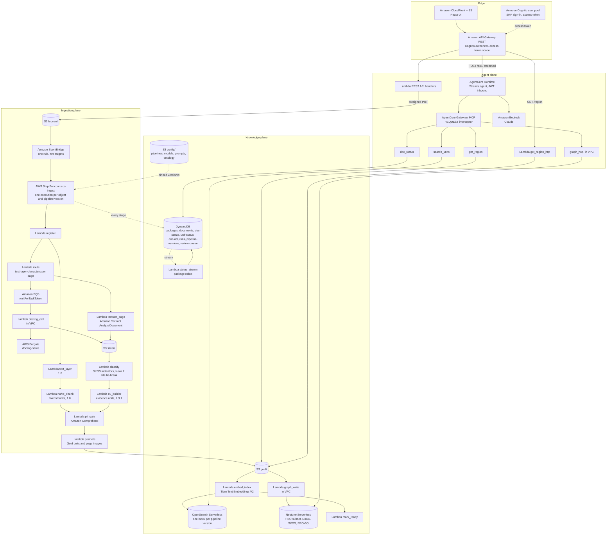
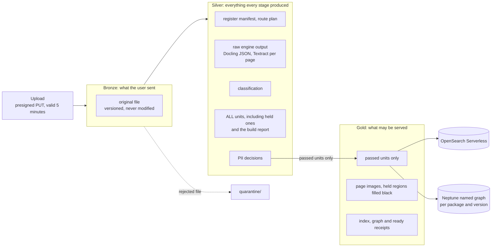
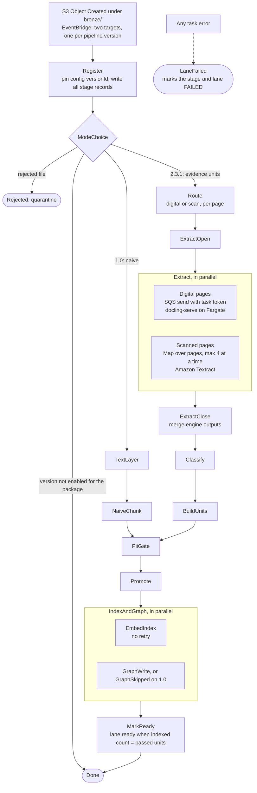
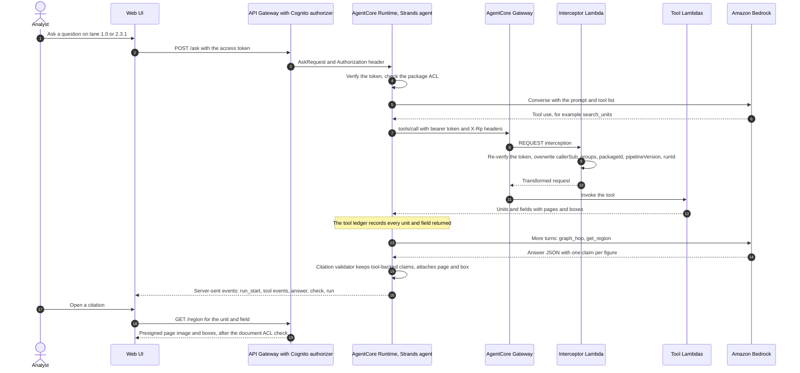

# Architecture

This guide describes the reference pipeline: its three planes, how data moves through Bronze, Silver and Gold,
the ingestion state machine, the contracts every component shares, and the security model. Where this guide
and the code disagree, the code is right. Please open an issue.

The [methodology pages](methodology/README.md) explain *why* each piece exists. This page explains *where* it
runs.

- [Overview](#overview)
- [The three planes on AWS](#the-three-planes-on-aws)
- [Data flow: Bronze, Silver and Gold](#data-flow-bronze-silver-and-gold)
- [The ingestion state machine](#the-ingestion-state-machine)
- [The ask path](#the-ask-path)
- [Contracts](#contracts)
- [Security model](#security-model)
- [Local mode: what is real and what is a stand-in](#local-mode-what-is-real-and-what-is-a-stand-in)
- [Deployment](#deployment)
- [Before you use this in production](#before-you-use-this-in-production)

---

## Overview

| Plane | Job | AWS services |
|---|---|---|
| **Ingestion** | Turn uploaded files into typed, governed evidence units, two pipeline versions side by side | Amazon S3, Amazon EventBridge, AWS Step Functions, AWS Lambda, Amazon SQS, AWS Fargate (docling-serve), Amazon Textract, Amazon Comprehend, Amazon Bedrock (Amazon Nova 2 Lite for classification tie-breaks) |
| **Knowledge** | Store units and facts so they can be filtered, searched and joined | Amazon OpenSearch Serverless (vector and BM25), Amazon Neptune Serverless (ontology and facts), Amazon DynamoDB (status, ACLs, runs), Amazon S3 (Gold), Amazon Bedrock (Amazon Titan Text Embeddings V2) |
| **Agent** | Answer questions with identity-aware tools, and cite every figure | Amazon Bedrock AgentCore Runtime and Gateway, a Strands agent, AWS Lambda (MCP tools and interceptor), Amazon Bedrock (Anthropic Claude) |
| **Edge** | Sign-in, API and UI | Amazon Cognito, Amazon API Gateway (REST), Amazon CloudFront with Amazon S3 |

Two pipeline versions run on every upload: `1.0` (text layer and fixed chunks, the control) and `2.3.1` (layout
extraction, evidence units and ontology binding). They are two executions of **one** state machine. Their configs
differ only in the `preprocessing` block. The retriever, `k`, prompt, model and agent are identical.

The reference deployment was tested in us-east-1.

## The three planes on AWS

AWS resource names use the prefix `rp-` (for example the state machine `rp-ingest` and the Lambda function
`rp-eu-builder`). The diagram drops the prefix for readability.

## Data flow: Bronze, Silver and Gold

Key layout in the data bucket. `pv` is the pipeline version (`1.0` or `2.3.1`). Every key has a helper in
[`evidence_core/s3keys.py`](../packages/evidence-core/evidence_core/s3keys.py).

| Prefix | Contents |
|---|---|
| `bronze/{ownerSub}/{packageId}/{fileName}` | The original upload |
| `quarantine/{packageId}/{docId}/{fileName}` | Rejected by `register`: not a PDF, encrypted, larger than 25 MB, or no pages |
| `silver/{packageId}/{docId}/{pv}/{stageId}/…` | Every stage's output: `register/manifest.json`, `route/route.json`, `extract/docling.json`, `extract/textract/p{NNN}.json`, `classify/classification.json`, `units/units.jsonl`, `units/build_report.json`, `pii_gate/decisions.json` |
| `gold/{packageId}/{docId}/{pv}/…` | `units.jsonl` (passed only), `units/{unitLocalId}.json`, `pages/p{NNN}.png` (150 dpi), `pages/held_regions.json`, `index/receipt.json`, `graph/abox.nq`, `graph/receipt.json`, `ready/receipt.json` |
| `config/…` | Pipeline YAML, models, prompts, and the built ontology (`vocab.json`, N-Quads, SPARQL templates), deployed by the CDK app |
| `runs/{runId}.json` | Full run records |

Rules:

- **Held units never leave Silver.** There is no "quarantine" for units. The PII gate decides, and only passed
  units are promoted.
- **Silver is never presigned.** Previews of Bronze and Silver objects go through the API, are capped at 64 KB,
  and mask long digit runs.
- **Stages are idempotent per document and pipeline version.** A rerun overwrites its own Silver and Gold keys.
  Indexing deletes the document's previous index entries first. The graph writer deletes the document's previous
  triples first.

## The ingestion state machine

The Amazon EventBridge rule on `Object Created` under `bronze/` has two targets on the same AWS Step Functions
state machine. Their input transformers set `pipelineVersion` to `1.0` and `2.3.1`.

| # | Stage | `1.0` | `2.3.1` | Runs on |
|---|---|---|---|---|
| 1 | `register` | Register | Register | Lambda, S3, DynamoDB |
| 2 | `route` | Skipped: no router | Route pages: more than 50 text-layer characters means digital | Lambda (pypdf) |
| 3 | `extract` | pypdf text layer | Digital pages: SQS → Lambda shim → docling-serve on Fargate. Scanned pages: Map → Amazon Textract | Lambda, SQS, Fargate, Textract |
| 4 | `classify` | Skipped: classify none | SKOS indicator phrases; Amazon Nova 2 Lite tie-break when the margin is below 0.15 | Lambda, Bedrock |
| 5 | `units` | Fixed 300-token chunks | Evidence units: phases A, B (τ 0.40) and C; fields with boxes; review items | Lambda, S3, DynamoDB |
| 6 | `pii_gate` | Amazon Comprehend per unit | Same | Lambda, Comprehend |
| 7 | `promote` | Gold units and page images | Same; held regions filled black | Lambda, S3 |
| 8 | `index` | Embed and index into `units-v1-0` | Into `units-v2-3-1` | Lambda, Bedrock (Titan V2), OpenSearch Serverless |
| 9 | `graph` | Skipped: ontology none | ABox named graph `urn:rp:graph:abox:{packageId}:{pv}` | Lambda in VPC, Neptune |
| 10 | `ready` | Lane ready | Same | Lambda, OpenSearch Serverless, DynamoDB |

How the state machine behaves:

- **Every task uses the same envelope.** Each Lambda task receives a `StageEnvelope` (`ctx`, prior `stages`,
  execution ARN, state name, attempt) and returns a `StageResult` of less than 8 KB. Large outputs go to S3, and
  the result carries their `ArtifactRef`s.
- **Docling runs behind a task token.** The Step Functions task sends an SQS message with a task token. A Lambda
  in the VPC waits for docling-serve to be healthy, sending heartbeats while the Fargate service scales from zero,
  then runs the conversion and calls `SendTaskSuccess`. The service scales on visible plus in-flight messages,
  between 0 and 2 tasks.
- **Failures are explicit.** Every task catches `States.ALL` and goes to `LaneFailed`. A second EventBridge rule
  on failed, timed-out or aborted executions acts as a backstop, so a lane cannot stay `RUNNING` forever.
- **Retries are deliberate.** Lambda service errors retry 3 times with backoff, and Amazon Textract throttling
  retries 5 times. `EmbedIndex` has no retry, so a retry can never create duplicate index documents.
- **Status is a side channel.** Each stage writes its `StageRecord` and events to the `doc-status` table. Its
  stream triggers a rollup into the `packages` table (lane state, counts of units, held, indexed and triples).
  The UI polls one API call per second, and the ask button turns on when both lanes are ready.

Code: the state machine definition is built in
[`infra/lib/ingest-asl.ts`](../infra/lib/ingest-asl.ts) (unit-tested). The stage registry is in
[`evidence_core/stages.py`](../packages/evidence-core/evidence_core/stages.py). Handlers are in
`services/lambdas/<stage>/handler.py`.

## The ask path

The run record (model, prompt hash, config hashes, corpus hash, tool calls, retrieved units, usage, latency,
answer) is written to S3 before the final `run` event, and a summary goes to the `runs` table.

`POST /ask` is either an HTTP proxy straight to the AgentCore Runtime, which streams, or a Lambda integration that
calls the Runtime. Which one is used depends on whether the Runtime ARN is known when the API stack deploys. The
API stack's `AskIntegration` output says which.

## Contracts

All components share one contract package,
[`packages/evidence-core/evidence_core/`](../packages/evidence-core/evidence_core/) (pydantic v2 models,
camelCase on the wire). JSON schemas are generated from it into [`contracts/generated/`](../contracts/generated/)
with `make contracts`. The UI's TypeScript types live in [`contracts/api.ts`](../contracts/api.ts). Tests fail
when either one drifts from the models.

| Contract | Defined in | What it fixes |
|---|---|---|
| Bounding box | `bbox.py` | `{page, x0, y0, x1, y1}`, PDF points, top-left origin, 1-based pages |
| Unit, member, field, provenance | `models/units.py` | What a retrievable unit is, for both lanes |
| Stage envelope, result and record; lane record; events | `models/status.py`, `status.py` | How every stage is called, and what it must record |
| Stage outputs | `models/stage_outputs.py` | The `output` of each stage's `StageResult` |
| Stage registry | `stages.py` | Order, group, per-lane variant or skip reason, engines, AWS services |
| S3 keys | `s3keys.py` | Every key above |
| DynamoDB tables | `ddb.py` (exported to `contracts/generated/tables.json`) | Keys, GSIs and item models for the eight tables |
| Pipeline config | `config.py` | Schema, `${MODEL}` resolution from `config/models.yaml`, config and block hashes, config diff |
| Retrieval | `retrieval.py` | Index mapping, filter, sub-queries, fusion |
| MCP tools | `models/tools.py` (exported to `contracts/generated/mcp_tools.json`) | Tool arguments and results; the injected fields the model never controls |
| Answer, claims, events, run record | `models/answer.py` | The answer payload, SSE events and `RunRecord` |
| Golden entries | `models/golden.py` | The evaluation set format |
| IRIs and named graphs | `iris.py` | Instance IRIs, TBox and ABox graph names, prefixes |

The REST routes the UI calls, with their access rules, are listed in the
[REST API reference](reference/rest-api.md). The rules the code relies on (the provenance contract, the frozen
control lane, the PII hold rule, the deferred invariants and what a replay may show) are short records in
[`docs/decisions/`](decisions/README.md).

**Governed definitions.** A definition the agent must use, such as "total income" (`fin:QualifyingIncome`), is an
ontology term in Git with a SPARQL template that computes it. `make ontology-check` writes a governance record
for it (`ontology/dist/<version>/governance/<name>.json`, served by `GET /governance/definitions/{name}`): the
term as built, the sha256 of its Turtle source and template, and the check results. The record can also carry a
recorded cross-check against the AWS Context Ontology Accelerator (`runs/local/coa/<date>/`, read by
`ontology/rpont/coa_snapshot.py`; `COA_MODE=off` leaves it out). Nothing in the deployed stack calls COA.

DynamoDB tables (on-demand capacity, point-in-time recovery on):

| Table | Key | Holds |
|---|---|---|
| `rp-packages` | `packageId` | Package, allowed principals, per-lane rollup and counters |
| `rp-documents` | `packageId`, `docId` | Upload state, sha256, page count, document type |
| `rp-doc-status` | `docId`, sort key by kind | Stage records, lane records and events (events expire after 30 days) |
| `rp-unit-status` | `unitId` | Per-unit state across PII gate, promotion, index and graph, including index IDs |
| `rp-doc-acl` | `docId` | The document ACL, checked before any region is served |
| `rp-runs` | `runId` | Run summaries (full records in S3) |
| `rp-pipeline-versions` | `pipelineVersion` | Enabled versions and their pinned config version IDs |
| `rp-review-queue` | `packageId`, review key | Fields below the confidence threshold |

## Security model

### Identity

- Users sign in to an Amazon Cognito user pool with SRP. The demo seeds two users in two groups,
  `lending-analyst` and `markets-analyst`, with `example.com` addresses.
- Every API method requires the **access token** scope. An ID token gets HTTP 401. The smoke test checks this.
- The AgentCore Runtime validates the same JWT with a custom JWT authorizer that allows only the web client.

### Authorization

- **Principals** are `user:` and `group:<name>`. A package's allowed principals and the document ACL are
  copied onto every unit at ingestion.
- **Search filters inside the query.** `search_units` places the principal, package and version filter inside
  both the vector and the BM25 sub-query. It is never a post-filter.
- **The graph is scoped by `FROM`.** `graph_hop` adds a package's ABox graph to the query's `FROM` clause only when
  the caller can read the package. It runs only allow-listed templates, with parameters bound as escaped literals.
- **Regions are checked before signing.** `get_region_http` checks the document ACL before it presigns a page
  image. Silver is never presigned.
- **The model cannot choose identity.** The AgentCore Gateway REQUEST interceptor re-validates the token against
  the user pool's JWKS on every `tools/call`. It then deletes and sets `callerSub`, `groups`, `pipelineVersion`,
  `packageId` and `runId` in the tool arguments. It is idempotent, and it rejects calls with an invalid token or a
  missing package header. As a second line, the tool wrapper strips any model-supplied values for those keys.
- **One narrow service-to-tool path.** The REST API may call `graph_hop` directly for one inspection view. That
  path runs a single allow-listed template, takes identity only from the API Gateway authorizer's claims, can
  invoke only the tool's published alias, and is marked in the tool's logs as API-originated.

### Data protection

- Amazon S3 uses SSE-KMS with one customer managed key, versioning and Block Public Access. CloudFront reads the
  UI bucket through origin access control.
- **PII gate.** Each unit's text goes to Amazon Comprehend `DetectPiiEntities`. A unit is held when Comprehend
  reports a configured entity type, at or above the minimum score, on an unmasked span with at least the
  configured number of digits (for example 9 for an SSN). Masked spans such as `XXX-XX-0417` pass as `masked`.
  Decisions record entity type, score, offsets and digit counts, never the matched text, and the module logs no
  text. Held units are never promoted, indexed or written to the graph, and their regions are filled black in
  page images.
- The UI masks 12-digit sequences, and operator scripts print account IDs masked.
- The demo password is generated at seed time into an AWS Systems Manager SecureString parameter.

### Network

- Amazon Neptune and the Lambda functions that talk to it (and the docling shim) run in **private isolated
  subnets** with no NAT gateway. Amazon S3 and DynamoDB are reached through gateway endpoints. One Step Functions
  interface endpoint lets the docling shim send task heartbeats and results.
- Neptune uses **IAM database authentication**. `graph_hop` can only read. `graph_write` and the admin function
  can write.
- Lambda functions in the VPC never call Amazon Bedrock, Amazon Comprehend, Amazon Textract or OpenSearch
  Serverless. Those calls happen outside the VPC, authorized by IAM and the OpenSearch Serverless data access
  policy.
- The **Amazon OpenSearch Serverless collection endpoint is public.** To keep the sample simple and cheap, its
  network policy sets `AllowFromPublic: true` (`infra/lib/knowledge-stack.ts`). Access is still gated by IAM
  (SigV4) and the collection's data access policy, which names only the pipeline and tool roles. For real data,
  switch the network policy to an OpenSearch Serverless VPC endpoint.
- The docling-serve task on AWS Fargate runs in a **public subnet with a public IP, only so it can pull the
  upstream container image**. Its security group accepts traffic on port 5001 only from the Lambda security
  group. For production, consider a private subnet with an Amazon ECR pull-through cache and VPC endpoints.

## Local mode: what is real and what is a stand-in

The local runners call **the same stage handlers with the same envelopes** as the AWS state machine. Local
output labels every stand-in in `run.json`.

| Concern | On AWS | Locally (`services/local_pipeline`, `services/local_agent`) |
|---|---|---|
| Orchestration | AWS Step Functions | An in-process runner that calls the same handlers in the same order |
| Storage | Amazon S3, Amazon DynamoDB | moto, in process |
| Layout, digital pages | docling-serve on AWS Fargate | The `docling` Python package if installed, otherwise a labeled pypdfium2 text-run fallback |
| Layout, scanned pages | Amazon Textract `AnalyzeDocument` | Docling OCR shaped as a Textract response, labeled *"NOT Amazon Textract"*. Unavailable without Docling |
| Embeddings | Amazon Titan Text Embeddings V2 on Amazon Bedrock | A deterministic hash embedder (not semantic), or real Titan with `--bedrock`, with responses recorded |
| PII | Amazon Comprehend | A regex stand-in (`PII=local`), or real Comprehend (`PII=aws`), with responses recorded |
| Index | Amazon OpenSearch Serverless | An in-memory exact k-NN and BM25 index with the same fusion |
| Graph | Amazon Neptune | pyoxigraph over the ABox the pipeline wrote, with the same SPARQL templates |
| Agent | AgentCore Runtime and Gateway | `local_agent`: the same tools through a local gateway that injects identity like the interceptor. The model call is real Amazon Bedrock |

Recorded Amazon Comprehend and Amazon Titan responses are kept in `runs/local/recorded/`, keyed by a hash of the
request. A rebuild with unchanged inputs replays them and makes no AWS call. The repository ships the Amazon
Comprehend recordings; the Titan recordings (about 4.5 MB) are not included, so the first `--bedrock` run on a
fresh clone calls Amazon Bedrock.

## Deployment

The AWS CDK app in [`infra/`](../infra/) (TypeScript) deploys five stacks:

| Stack | Contents |
|---|---|
| `rp-base` | KMS key, data bucket with EventBridge notifications, DynamoDB tables, VPC with gateway endpoints, config deployment |
| `rp-knowledge` | OpenSearch Serverless collection and policies, Neptune Serverless cluster, graph loader and admin functions |
| `rp-ingest` | The state machine, stage functions, SQS queue and dead-letter queue, docling-serve on Fargate, EventBridge rules |
| `rp-agent` | Cognito user pool and groups, REST API, tool functions, interceptor, Gateway and Runtime roles |
| `rp-web` | UI bucket and CloudFront distribution with an `/api/*` behavior |

The AgentCore Runtime and Gateway are created by
[`scripts/deploy_agentcore.sh`](../scripts/deploy_agentcore.sh), not by CDK. The Runtime uses direct code
deployment (a zip in the data bucket). Lambda code and layers are built without Docker by
[`scripts/build_lambdas.sh`](../scripts/build_lambdas.sh). [`scripts/deploy.sh`](../scripts/deploy.sh) runs the
whole sequence in order: build, bootstrap, core stacks, AgentCore, agent stack, UI, web stack and seed.

The target account comes from your active AWS credentials (`CDK_DEFAULT_ACCOUNT`), or from
`-c rp:account=<account-id>` if you pin it. The Region comes from the `rp:region` context, which the Makefile and
`scripts/deploy.sh` set from `AWS_REGION` (default `us-east-1`). Credentials come from the standard AWS credential
chain, or `AWS_PROFILE` if you set one. Nothing account-specific is stored in the repository.

## Before you use this in production

This is a reference implementation built to show the patterns clearly. Review at least the following before you
run it on real data:

- **Threat model and data classification** for your documents. The PII gate is a demonstration control.
- **Network:** switch the OpenSearch Serverless network policy from public access to a VPC endpoint, move
  docling-serve to a private subnet, and review every security group and endpoint policy.
- **IAM:** review every role against least privilege for your account structure.
- **Invariants:** the evidence-unit invariants are recorded but not enforced in this build. See
  [pattern 2](methodology/02-evidence-units.md).
- **Scale:** the docling-serve service scales between 0 and 2 tasks, and OpenSearch Serverless capacity is capped.
  Size both for your volume.
- **Observability:** logs are structured JSON with `docId`, pipeline version and `stageId`. Add alarms on failed
  lanes, the dead-letter queue and budget thresholds.
- **Teardown leftovers:** the AWS KMS key and the Lambda layer versions are retained on purpose, and
  `scripts/teardown.sh` keeps the `/aws/lambda/rp-*` log groups. Decide how long each should live in your account.
- **Retention:** set lifecycle rules for Bronze, Silver, Gold and run records that match your policies.
