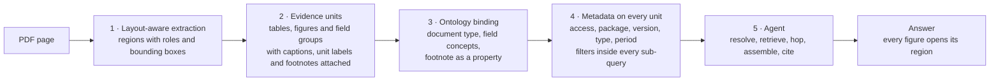

# Methodology

This folder explains the method behind the repository. You can apply it with or without this codebase.

| Page | Read it when you want to |
|---|---|
| [01 · Layout-aware extraction](01-layout-aware-extraction.md) | Stop losing the link between a label and its value |
| [02 · Evidence units with invariants](02-evidence-units.md) | Replace fixed-size chunks with units that keep tables, captions and footnotes together |
| [03 · Ontology-driven classification](03-ontology-driven-classification.md) | Type documents and fields against a governed vocabulary, and turn footnotes into facts |
| [04 · Metadata at ingestion, filters inside the query](04-metadata-and-filters-inside-the-query.md) | Enforce access and scope in retrieval without losing recall |
| [05 · Resolve → retrieve → hop → assemble → cite](05-resolve-retrieve-hop-assemble-cite.md) | Make an agent's every figure point to a page region |
| [The provenance contract](provenance-contract.md) | Know what every unit, answer and run must carry, and why |
| [Evaluation](evaluation.md) | Measure preprocessing changes honestly |

Each pattern also has a hands-on quickstart in [`docs/quickstarts/`](../quickstarts/). To apply the method to
your own documents, see [Build your own use case](../quickstarts/10-build-your-own-use-case.md).

---

## The thesis

**Most RAG failures start in preprocessing.** By the time a retriever runs, the damage is usually done. The
label "Wages, tips, other compensation" is no longer next to 98,400.00. The footnote that says "Q4 figures are
preliminary" is in a different chunk from Table 3. The coupon's step-up rule is on page 2, and the coupon is on
page 1.

**The region boundary has to hold.** A region is a typed area of a page: a page number, a bounding box and a
role such as `table`, `key_value` or `footnote`. If every figure stays attached to its region from extraction to
answer, three things follow:

- Retrieval returns units that still mean something.
- The graph can hold typed facts with the region they were read from.
- The agent can cite a box on a page that a person can open, instead of a chunk of text.

## How the patterns chain

Each pattern consumes what the previous one guarantees.

They sit on three planes:

| Plane | What it owns | Patterns |
|---|---|---|
| **Ingestion** | Turning files into typed, governed units: extraction, units, classification, the PII gate | 1, 2, 3 |
| **Knowledge** | Storing units and facts so they can be filtered and joined: vector and BM25 index, graph, status and ACL tables | 3, 4 |
| **Agent** | Answering with tools that respect identity, and checking every figure against what the tools returned | 4, 5 |

The [architecture guide](../architecture.md) maps each plane to AWS services.

## Measure with a control lane

Preprocessing changes are hard to judge by eye. This repository runs two pipeline versions side by side, on the
same documents, through the same state machine:

- `1.0`: text-layer extraction and fixed 300-token chunks. This is the control.
- `2.3.1`: layout-aware extraction, evidence units and ontology binding.

The two configs, [`config/pipelines/v1.0.yaml`](../../config/pipelines/v1.0.yaml) and
[`config/pipelines/v2.3.1.yaml`](../../config/pipelines/v2.3.1.yaml), differ **only** in their `preprocessing`
block. Retrieval, model, prompt and agent settings are identical, and a test fails if that ever changes
(`test_only_preprocessing_differs` in
[`packages/evidence-core/tests/test_config_stages.py`](../../packages/evidence-core/tests/test_config_stages.py)).
Every run record carries a hash of each config block, so you can prove two answers came from the same retrieval
and generation settings.

You can use the same technique in your own system. Version your pipeline as configuration, keep one lane as the
control, and change one block at a time.

## Bring your own documents

Most of a new use case is data. The table lists what you change for your own documents and where it lives
today. It is a summary; the [Build your own use case](../quickstarts/10-build-your-own-use-case.md#how-much-is-configuration-and-how-much-is-code)
guide has the full table and walks through each row.

| You want to add | Where | Data or code |
|---|---|---|
| Documents | A folder of PDFs, then `make units PACKAGE=<folder>` or `make e2e-local PACKAGE=<folder> PII=local`. An optional `gold.json` sets the package ID and allowed groups | Data |
| Document types | SKOS concepts with `rp:indicator` phrases in [`ontology/src/rp/doctypes.ttl`](../../ontology/src/rp/doctypes.ttl). Bump the ontology version and run `make ontology-check` | Data |
| Field concepts and their printed labels | `skos:prefLabel` and `skos:altLabel` in [`ontology/src/rp/fin.ttl`](../../ontology/src/rp/fin.ttl), or a vocabulary of your own | Data |
| Layout roles and engine label mapping | [`ontology/src/rp/roles.ttl`](../../ontology/src/rp/roles.ttl) (`skos:exactMatch` from Docling and Amazon Textract labels) | Data |
| Unit thresholds | `preprocessing.units` in the pipeline YAML: `tau`, `markerLink`, `maxResidualTokens`, `reviewMinConfidence` | Data |
| PII rules | `preprocessing.piiGate`: entity types, minimum score, unmasked-digit thresholds | Data |
| Definitions the agent must use | [`prompts/answer_v1.txt`](../../prompts/answer_v1.txt) and the defined quantity in the ontology (for example `fin:QualifyingIncome`) | Data |
| Graph questions | A SPARQL template in [`ontology/templates/`](../../ontology/templates/), plus its id in three registries (listed below) | Both: the `.rq` file is data; each registry needs one line of code |
| Models | [`config/models.yaml`](../../config/models.yaml) | Data |
| Golden questions | [`eval/golden.jsonl`](../../eval/golden.jsonl): question, answer, answer pattern, page and gold bounding box | Data |
| Access groups | `USER_GROUPS` in [`infra/lib/names.ts`](../../infra/lib/names.ts), the demo users in [`scripts/lib/rp_ops/auth.py`](../../scripts/lib/rp_ops/auth.py), and `allowedGroups` per package | Code (AWS only); `allowedGroups` is data |
| A new extraction engine | An adapter that returns the canonical layout model, plus a router entry | Code |

A few domain rules are still code. They are small and listed here so you know where to look:

- Period and party detection: [`services/lambdas/ingest_lib/periods.py`](../../services/lambdas/ingest_lib/periods.py).
- Party links and the footnote step-event rule: [`services/lambdas/ingest_lib/rdf.py`](../../services/lambdas/ingest_lib/rdf.py).
- Currency and "in millions" unit labels: `UNIT_LABEL_RE` in [`services/lambdas/eu_builder/builder.py`](../../services/lambdas/eu_builder/builder.py).
- SPARQL template registration: `GRAPH_TEMPLATES` in `evidence_core/models/tools.py`, `TEMPLATE_SPECS` in
  `services/lambdas/tools/_lib/templates.py` and `TOTAL_TEMPLATES` in
  `services/lambdas/tools/graph_hop/handler.py`.

## Glossary

| Term | Meaning here |
|---|---|
| **Region** | A page number plus a bounding box, in PDF points with a top-left origin and 1-based pages: `{page, x0, y0, x1, y1}` |
| **Role** | What a layout block is: `title`, `section_header`, `text`, `table`, `key_value`, `caption`, `footnote`, `picture`, `page_header`, and so on. Aligned to DoCO |
| **Evidence unit** | A retrievable unit built around a table, figure or field group, with its caption, unit label and footnotes attached. Types: `table_panel`, `figure_panel`, `field_group`, `section_text`, `list_block` |
| **Field** | A labeled value inside a unit (a W-2 box, a payslip line), with its own bounding box and, when typed, an ontology concept |
| **Lane** | One pipeline version processing the same documents as the others, side by side. Configurations of the lanes differ only in `preprocessing` |
| **Control lane** (naive lane) | Pipeline version `1.0`: PDF text layer and fixed 300-token chunks. The baseline that shows what the same agent does without the patterns |
| **X-ray** | An inspection view that draws on the page what the control lane read, and in what order. It never extracts anything |
| **N of N** | How results of repeated runs are reported: "correct in 3 of 5 runs", with agent errors counted separately, never folded into a single score |
| **Build report** | The JSON file the evidence-unit builder writes per document: how each block was placed (phase A, B or C), scores, marker links, review items and the invariants record |
| **Bronze, Silver, Gold** | Original uploads; every stage output; units that passed the PII gate, with page images |
| **TBox, ABox** | The ontology (classes and properties); the facts the pipeline wrote for one package and version |
| **N-Quads** | A plain-text graph file format: one statement per line, each with a named graph. The ontology build and the graph stage write it |
