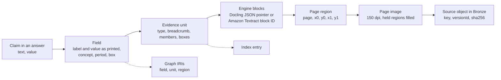

# The provenance contract

The five patterns only help if every step keeps its promises. This page lists those promises: what every region,
unit, field, stage, fact, answer and run must carry, and how this repository checks them. Treat it as a checklist
for your own pipeline.

The short version: **every figure can be traced to a box on a page of a specific object version, and every
answer can be tied to the exact config, prompt, model and corpus that produced it.**

---

## The lineage chain

For any figure in an answer, you can walk back to the uploaded file:

`GET /units/{unitId}/lineage?field=<fieldId>` returns this chain as ordered steps. Fixed chunks in the control
lane stop early: chunk → page text layer → source. They have no field, no engine block and no region.

## The rules

### 1. One coordinate frame

Every bounding box everywhere is `{page, x0, y0, x1, y1}` in PDF points, with a top-left origin and 1-based
pages. Engines are converted at their adapter. Nothing downstream converts again.

Code: [`packages/evidence-core/evidence_core/bbox.py`](../../packages/evidence-core/evidence_core/bbox.py).

### 2. Units and fields carry their own provenance

| Object | Must carry |
|---|---|
| **Unit** | `unitId`, `docId`, `packageId`, `pipelineVersion`, `unitType`, label, breadcrumb, text, pages, `bboxes`, members (each with role, box and a pointer into the engine output), fields, `fieldConcepts`, `period`, `piiFlag`, `allowedPrincipals`, confidence, and a provenance record: engine, engine version, ontology version, frame, source key, source `versionId`, source sha256, config sha |
| **Field** | `fieldId`, label and value **as printed**, normalized decimal value, currency, concept, period, its own `bbox`, the source (for example "textract KEY_VALUE_SET"), engine confidence, and block references |

Code: [`packages/evidence-core/evidence_core/models/units.py`](../../packages/evidence-core/evidence_core/models/units.py).

### 3. Every stage writes a record, including stages that did not run

Each stage writes a `StageRecord` with:

- state, attempt, timestamps, duration and heartbeats;
- input and output artifacts as `ArtifactRef` (S3 key, `versionId`, sha256, size);
- the config slice it read and its sha;
- versions: `pipelineVersion`, `configSha`, `configVersionId`, `ontologyVersion`, engine version, `modelId`,
  `promptSha` and `codeSha`;
- any error, with its cause.

The first stage writes every stage's record up front, as `PENDING` or as `SKIPPED` with a reason (for example
`1.0 · graph · ontology none`). An inspector can then show why a stage never ran.

Code: [`packages/evidence-core/evidence_core/status.py`](../../packages/evidence-core/evidence_core/status.py)
(`@stage_handler`, `StatusWriter`) and [`stages.py`](../../packages/evidence-core/evidence_core/stages.py).

### 4. Config is pinned per execution

The first stage pins the Amazon S3 `versionId` of the pipeline config. Every later stage reads exactly that
version. The config hash is the sha256 of the canonical JSON of the resolved config. Each block (`preprocessing`,
`retrieval`, `generation`, `agent`) also has its own hash, so you can prove two lanes share everything except
preprocessing.

Code: [`packages/evidence-core/evidence_core/config.py`](../../packages/evidence-core/evidence_core/config.py).

### 5. Nothing is lost, and held data stays put

- **Silver** keeps every stage output, including units the PII gate held, and the gate's decisions.
- **Gold** holds only passed units, page images (with held regions filled black) and receipts.
- Held units are never promoted, indexed or written to the graph. The PII decision records entity type, score,
  offsets and digit counts, never the matched text.

### 6. Every fact in the graph points back

Every `fin:FieldValue`, party and step event in the graph is `prov:wasDerivedFrom` its unit and its page region.
Each package and pipeline version writes to its own named graph, `urn:rp:graph:abox:{packageId}:{pipelineVersion}`.
A rerun deletes that document's previous triples first.

### 7. Answers cite only what tools returned

Claims are kept only if a tool returned their unit and field in this session, with a matching value. Page and box
come from the tool results, never from model text. Figures that are not accounted for are listed in
`uncitedNumbers` and shown to the user. See [pattern 5](05-resolve-retrieve-hop-assemble-cite.md).

### 8. Every run is recorded

A `RunRecord` holds `runId`, the question, `pipelineVersion`, `modelId`, `promptSha`, `configSha`, `blockShas`,
`corpusHash` (a hash over the package's source sha256s), `memoryRecordsInjected` (0: agent memory is off), every
tool call with its input and result summary, the retrieved units and text, token usage, latency, the answer and
the golden-set check when one applies.

Code: [`packages/evidence-core/evidence_core/models/answer.py`](../../packages/evidence-core/evidence_core/models/answer.py),
[`services/agent/rp_agent/runner.py`](../../services/agent/rp_agent/runner.py).

### 9. Stand-ins say so

When something is not the real service, the output says so in plain words. Local builds write labels such as:

- *"pyoxigraph in-process (NOT Amazon Neptune)"*
- *"local Docling OCR shaped as a Textract response (NOT Amazon Textract)"*
- *"local-hash-embedder (NOT Titan; deterministic, not semantic)"*

Logged runs carry a provenance label such as *"local run · Bedrock"* with a note that they were *"asked on a
developer machine against the local pipeline's outputs; not the deployed AWS stack."* Never present a local result
as a production result.

### 10. Deterministic where it can be

The sample generator is byte-identical across runs, and a test fails if the checked-in samples drift. Local
pipeline outputs (units, graph, graph answer) are reproducible for the same inputs. Recorded responses from
Amazon Comprehend and Titan embeddings are keyed by a hash of the input, so a rebuild replays them offline.

## How the repository enforces the contract

| Check | Where |
|---|---|
| Generated JSON schemas match the models | `test_generated_contracts_are_current` in [`packages/evidence-core/tests/test_models_retrieval.py`](../../packages/evidence-core/tests/test_models_retrieval.py), and [`tests/integration/test_contract_mirror.py`](../../tests/integration/test_contract_mirror.py) for the UI types |
| Pipeline versions differ only in `preprocessing` | `test_only_preprocessing_differs` in [`packages/evidence-core/tests/test_config_stages.py`](../../packages/evidence-core/tests/test_config_stages.py) |
| Stage records and status rollups | [`packages/evidence-core/tests/test_status.py`](../../packages/evidence-core/tests/test_status.py), [`tests/integration/test_stage_registry.py`](../../tests/integration/test_stage_registry.py) |
| Citation validation | [`services/agent/tests/test_citations.py`](../../services/agent/tests/test_citations.py) |
| Lineage over a real pipeline run | [`services/lambdas/api/tests/test_api_units_lineage.py`](../../services/lambdas/api/tests/test_api_units_lineage.py), [`tests/integration/test_inspection_over_pipeline.py`](../../tests/integration/test_inspection_over_pipeline.py) |
| End-to-end local build, with the expected graph answer | [`tests/integration/test_local_e2e.py`](../../tests/integration/test_local_e2e.py) |
| Sample data rules (truncated SSNs, unissued EIN prefix, no routing numbers) | [`data/tests/`](../../data/tests/) |

## Adopt it

If you take only one thing from this page, take this checklist:

- [ ] One bounding-box frame, converted once at the engine adapter.
- [ ] Every unit and field carries its source object version, its box and a pointer into the engine output.
- [ ] Every stage records inputs and outputs with hashes, the config slice it read, and the versions in play.
- [ ] Config is versioned and pinned per execution. Each config block has its own hash.
- [ ] Held or rejected data stays in a restricted zone with its decision, and never reaches the index or graph.
- [ ] Graph facts point back to units and regions.
- [ ] Answers cite only tool results. Uncited figures are shown, not hidden.
- [ ] Every run records model, prompt hash, config hashes, corpus hash, tool calls and usage.
- [ ] Every stand-in is labeled as a stand-in.
